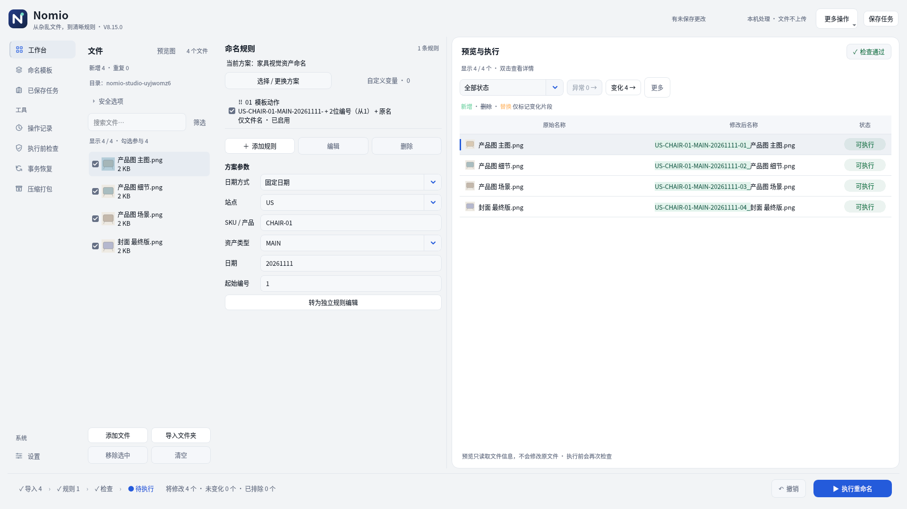
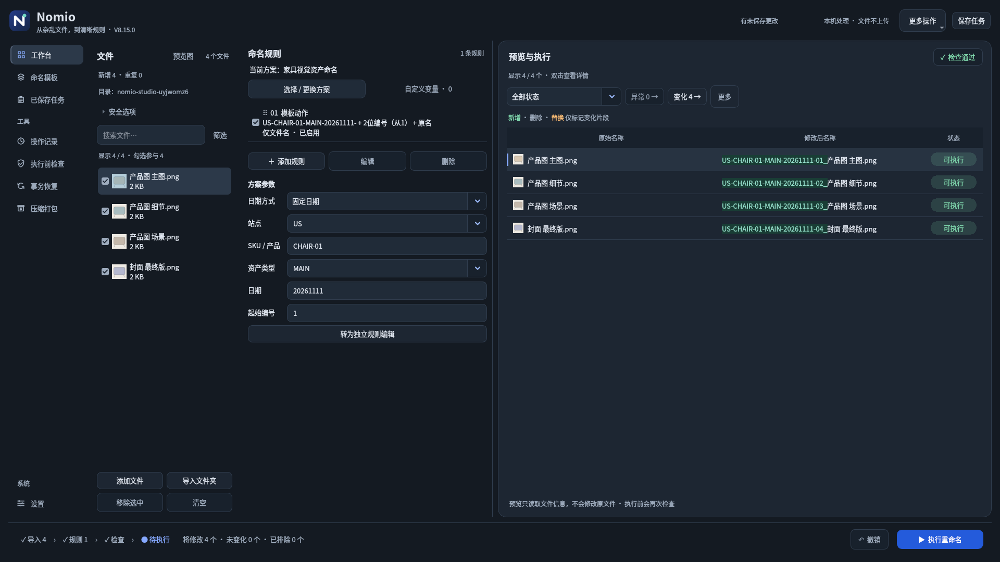

# Nomio V8.15.0

**从杂乱文件，到清晰规则。**

[直接下载 V8.15 完整源码包](https://raw.githubusercontent.com/Nepenthe396/Nomio/main/releases/NOMIO_V8.15_Source.zip) · [SHA-256](releases/NOMIO_V8.15_Source.zip.sha256) · [验证报告](releases/NOMIO_V8.15_Verification.md)

完整解压至新目录，运行 `NOMIO_V8.15/run.bat`，确认版本8.15.0。需要Python 3.10+，首次启动安装依赖；异常运行run-debug.bat。源码包不含预编译exe，旧exe不会自动更新。

## 本版变化

- 恢复文件→规则→预览→执行顺序，规则参数区域加宽，预览保持最大空间。
- 正文/控件/文件名13px、辅助12px、标题16px，缩紧控件与行距；Windows优先微软雅黑界面字体，缺少则使用内置无衬线后备。
- 去除重复的新名横幅，只在表格对照原名/新名。富文本文件名明确指定同一字体与字号。
- 勾选框显示勾号，明确勾选参与、点击查看；筛选默认只改变显示，预览排序不改变编号顺序。预览更新期间禁止执行及复制旧结果。
- 保留自定义、全部参数、完整导航、最近/收藏模板、保护续号、任务恢复、完成后继续添加/新批次与撤销入口。

## 实际界面

[1366宽浅色](releases/NOMIO_V8.15_Preview_Light.png) · [导入状态](releases/NOMIO_V8.15_Intake.png) · [执行结果](releases/NOMIO_V8.15_Result.png) · [安全追加](releases/NOMIO_V8.15_Safe_Append.png) · [任务恢复](releases/NOMIO_V8.15_Restored.png) · [千文件](releases/NOMIO_V8.15_1000_Files.png)

## 验证与边界

Linux Qt offscreen完整回归225项通过，新增6项并更新18项布局/交互测试。真实临时文件执行、追加05续号、保存恢复及撤销流程通过。千文件导入含布局0.760秒、参数更新含布局0.417秒，末行高度满足全文展示。

Windows字体选择分支仅模拟测试，Windows实机/ClearType/高DPI/多屏/网络盘及真实长期使用未验证。任务保存引用和设置，不备份内容；引用检查使用大小/修改时间/可访问性，不是内容哈希。撤销恢复名称，不恢复内容。旧任务缺少分组元数据时需核对起始值。

旧版交付保留在releases目录。
