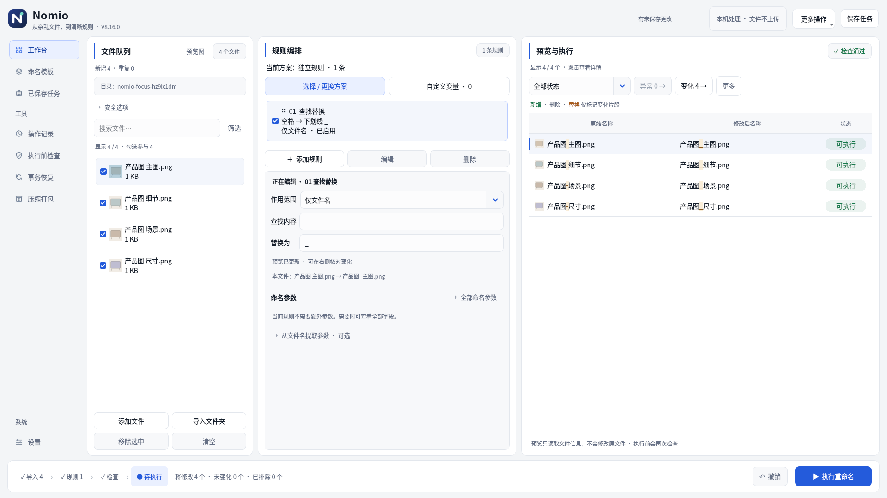
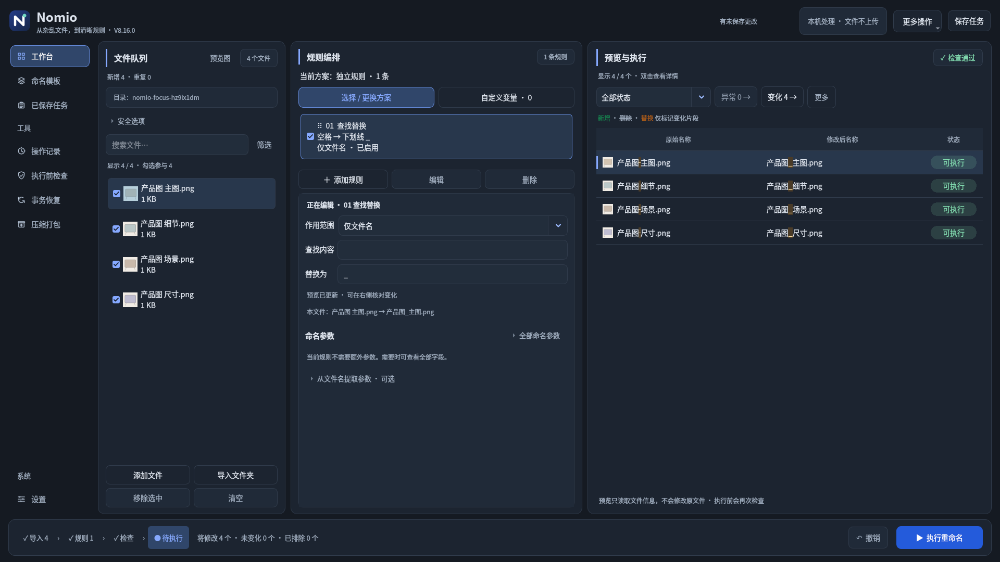

# Nomio V8.16.0

**从杂乱文件，到清晰规则。**

[直接下载 V8.16 完整源码包](https://raw.githubusercontent.com/Nepenthe396/Nomio/main/releases/NOMIO_V8.16_Source.zip) · [实际交互演示](releases/NOMIO_V8.16_Interaction.gif) · [SHA-256](releases/NOMIO_V8.16_Source.zip.sha256) · [验证报告](releases/NOMIO_V8.16_Verification.md)

完整解压至新目录，运行 `NOMIO_V8.16/run.bat`，确认版本8.16.0。需要Python 3.10+，首次启动安装依赖；异常运行run-debug.bat。源码包不含预编译exe，旧exe不会自动更新。

## 本版重点

以V8.13三栏外观为基础，打磨“选中规则→修改参数→预览回应”。保留浅色背景、卡片边框、品牌蓝和文件→规则→预览顺序；正文14px、辅助12px、标题16px，统一字体、勾选和焦点。

- 常用规则选中后就近编辑，标明正在编辑的对象。输入立即入模型，切换规则、保存与排序不丢最后一次输入。
- 模板参数聚焦关联，命名变量与全部参数在同区可达；脚本和高级模板动作仍使用完整设置窗口。
- 编辑状态与阶段例子就近显示；预览更新保持焦点和查看位置，正则错误阻止执行，全部新名复制入口防止使用旧结果。
- 文件与预览按完整路径双向定位，尊重筛选，不改变参与勾选和执行编号。
- 保留保护续号、任务/草稿、追加恢复、完成后继续添加/新批次和撤销。

## 实际界面

[就近修改](releases/NOMIO_V8.16_Inline_Edit.png) · [模板参数焦点](releases/NOMIO_V8.16_Template_Focus.png) · [左右定位](releases/NOMIO_V8.16_Linked_Selection.png) · [执行结果](releases/NOMIO_V8.16_Result.png) · [保护追加](releases/NOMIO_V8.16_Safe_Append.png) · [千文件](releases/NOMIO_V8.16_1000_Files.png)

## 验证与边界

Linux Qt offscreen完整回归245项通过，新增20项交互与真实文件测试。实际临时文件执行、05续号、保存恢复与撤销通过。千文件导入含布局0.922秒、参数更新含布局0.663秒，末行171px满足全文展示。交互GIF来自实际窗口抓帧，不是设计稿或Windows实机录像。

Windows字体选择分支仅模拟测试；Windows实机/ClearType/高DPI/多屏/网络盘及真实长期连续使用未验证。任务保存引用和设置，不备份内容；引用检查依据大小/修改时间/可访问性，不是内容哈希。撤销恢复名称，不恢复内容。旧任务缺少分组元数据时需核对起始值。

旧版交付保留在releases目录。
