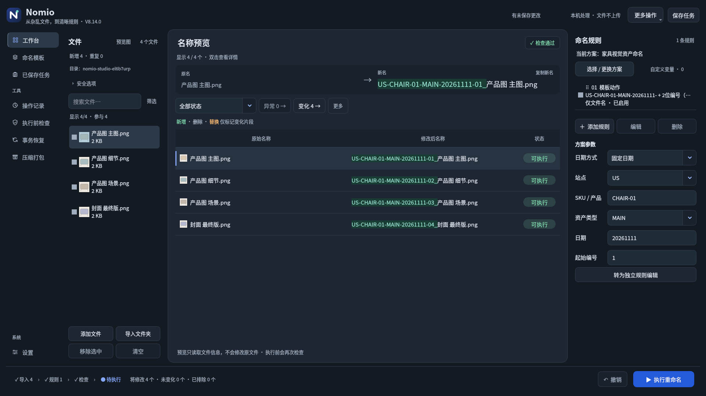
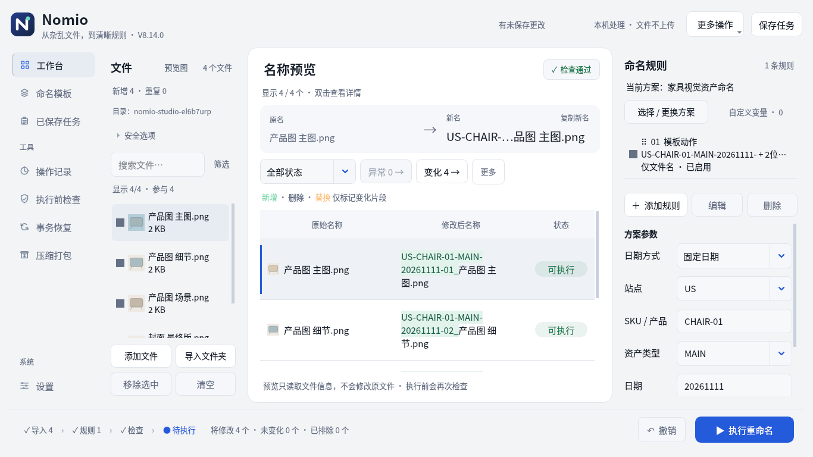

# Nomio V8.14.0

**从杂乱文件，到清晰规则。**

[直接下载 V8.14 完整源码包](https://raw.githubusercontent.com/Nepenthe396/Nomio/main/releases/NOMIO_V8.14_Source.zip) · [SHA-256](releases/NOMIO_V8.14_Source.zip.sha256) · [验证报告](releases/NOMIO_V8.14_Verification.md)

完整解压至新目录，运行 `NOMIO_V8.14/run.bat`，确认版本8.14.0。需要Python 3.10+，首次启动安装依赖；异常运行run-debug.bat。本包不含预编译exe，旧exe不会自动更新。字体已随包附带。

## 本版变化

- 文件／中央名称预览／命名规则：预览占主要空间，侧栏更紧凑，减少重复外框、蓝色填充和加粗文字。
- 当前文件原名→新名概览，语义差异底色与完整复制；等待更新时禁用复制。
- 完成后只显示实际名称，提供继续添加、新批次与可用的撤销入口；追加恢复对照。
- 自定义、全部参数、模板库最近/收藏和完整导航保持可达；筛选按需展开，原有图片预览偏好保留。
- 保留任务/草稿区分、已处理保护、续号、恢复检查和实际执行限定动效。

## 界面

[导入状态](releases/NOMIO_V8.14_Intake.png) · [执行结果](releases/NOMIO_V8.14_Result.png) · [安全追加](releases/NOMIO_V8.14_Safe_Append.png) · [任务恢复](releases/NOMIO_V8.14_Restored.png) · [千文件](releases/NOMIO_V8.14_1000_Files.png)

## 验证与边界

Linux Qt offscreen完整回归219项通过（本版新增18项）。真实临时文件执行、继续添加、续号、保存恢复及撤销流程通过。千文件测试：导入含布局0.811秒、参数更新含布局0.439秒，末行高度满足全文展示。

Windows实机、高DPI、多显示器、网络盘与真实长期连续使用未验证。任务保存文件引用和设置，不备份文件内容；文件引用检查使用大小/修改时间/可访问性，不是内容哈希。撤销恢复名称，不恢复内容。旧任务缺少分组续号信息时需核对起始值。

旧版交付保留在releases目录。
