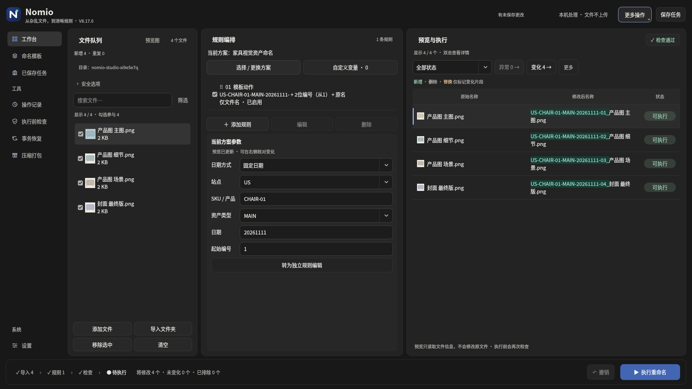
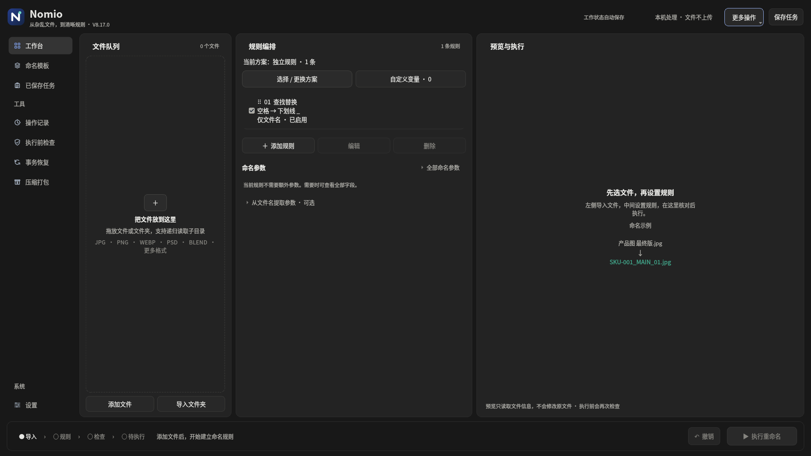

# Nomio V8.17.0

**从杂乱文件，到清晰规则。**

[直接下载 V8.17 完整源码包](https://raw.githubusercontent.com/Nepenthe396/Nomio/main/releases/NOMIO_V8.17_Source.zip) · [深色空状态](releases/NOMIO_V8.17_Empty_Dark.png) · [SHA-256](releases/NOMIO_V8.17_Source.zip.sha256) · [验证报告](releases/NOMIO_V8.17_Verification.md)

完整解压至新目录，运行 `NOMIO_V8.17/run.bat`，确认版本8.17.0。需要Python 3.10+，首次启动安装依赖；异常运行run-debug.bat。源码包不含预编译exe，旧exe不会自动更新。

## 本版：深色层级调整

- 中性炭灰取代大面积蓝灰，背景、工作面、参数区和输入按明度分层。
- 柔白正文、中性辅助文字；导航、方案、勾选和步骤减少蓝色填充。
- 弱化重复边框、目录/计数标签和空状态虚线，输入焦点与主要执行仍有明确强调。
- 禁用执行按钮不再亮蓝；下拉箭头默认中性灰，聚焦或展开才蓝色。
- 浅色样式、V8.16就近规则编辑、预览联动、任务/保护续号与恢复能力保留。

## 实际界面

[输入焦点](releases/NOMIO_V8.17_Focused_Input.png) · [就近编辑](releases/NOMIO_V8.17_Inline_Edit.png) · [异常状态](releases/NOMIO_V8.17_Error.png) · [执行结果](releases/NOMIO_V8.17_Result.png) · [浅色](releases/NOMIO_V8.17_Preview_Light.png) · [保护追加](releases/NOMIO_V8.17_Safe_Append.png)

## 验证与边界

Linux Qt offscreen完整回归251项通过，新增6项文字对比度、实际渲染状态、主题切换数据保持及浅色回切检查。真实临时文件执行、05续号、保存恢复及撤销通过。千文件导入含布局0.787秒、参数更新含布局0.422秒，末行171px满足全文展示。

Windows实机字体/ClearType/高DPI/多屏/原生标题栏、网络盘与真实长期使用未验证。任务保存引用和设置，不备份内容；引用核验依据大小/修改时间/可访问性，不是内容哈希。撤销恢复名称，不恢复内容。旧任务缺少分组元数据时需核对起始值。

旧版交付保留在releases目录。
